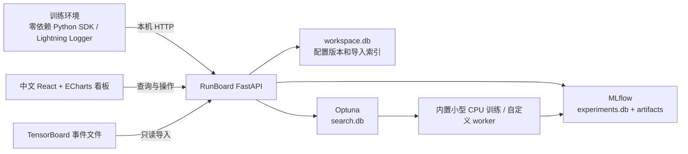

# RunBoard v0.2 架构

## 数据身份与持久化

- MLflow run ID 是实验的唯一标识；参数不可变，指标可按 Step 追加。
- 同一步骤的重复日志在图上展示最新时间的值，原记录保留在数据库；导出与图表口径一致。
- 笔记、来源、置顶和归档保存在 run tags；归档不删数据。
- 模板每次保存插入新记录，界面展示其版本 ID。
- TensorBoard 导入用原日志绝对路径映射到固定 run ID；按事件时间、Step、数值去重，图片保留最新四帧。
- Optuna 保存搜索空间、采样策略、种子、目标方向、trial 参数/结果，以及对应的 MLflow run ID。
- 标签、分组与环境信息保存在明确命名的run tags；续记核对参数、恢复RUNNING并从全部已记指标的最大step加1开始。
- 文本日志保存在workspace.db的logs表，按run ID及递增日志ID分页；写入前脱敏常见凭据格式。
- 资源采样在SDK记录指标时按指定间隔执行，GPU通过本机nvidia-smi读取，采样结果以system/指标写入同一实验。
- 图片、音视频、PDB与JSON图表沿用既有artifact通道；网页按文件类型预览，HTML/SVG保持附件下载。PDB视图仅解析第一模型Cα。

## 隔离与运行边界

基础 wheel 没有第三方依赖；HTTP SDK 不导入 MLflow/FastAPI，从而兼容原课程 Pydantic 1 环境。服务端通过 `[server]` 安装到独立环境。可选 Lightning 模块依赖用户已有 Lightning。

服务只监听 `127.0.0.1`，限制 Host 和浏览器跨来源写入。日志导入限制在启动时指定的工作目录。文件下载校验 run 对应目录及本地 artifacts 边界；内联预览仅允许 PNG/JPEG/WebP/GIF。凭据字段在配置入口拒绝；不自动采集环境变量。MLflow 遥测默认禁用。

内置搜索由一个本地线程串行运行，目标函数执行真实小型训练。网页不接受任意 shell 命令或代码；自定义目标由用户显式通过 CLI 导入。网页状态修改不控制外部训练进程。

## 视觉

米白纸面、黑色文字、朱红强调；固定网格、细分隔线、统一间距。构成主义几何仅用于品牌和提示区域；指标图保持坐标清晰。桌面主视图和 390px 窄屏均纳入浏览器验收。
