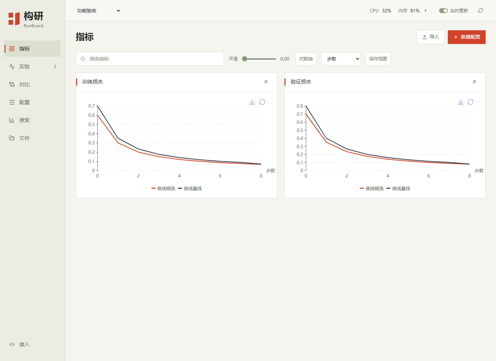

# 构研 RunBoard

本地优先的中文深度学习实验监控器。基于 MLflow、Optuna 和 ECharts，支持 PyTorch / Lightning。Apache 2.0，使用系统字体，无需云端账户。



*界面示例使用功能验收数据。*

## 功能

- **记录与比较**：指标、超参数、标签、分组、笔记、最近/最优值和基线差异。
- **训练监控**：CPU、内存、磁盘、网络和 NVIDIA GPU；文本与显式控制台日志。
- **多任务进度**：同屏查看各实验的训练轮次、平均每轮耗时、预计剩余时间和超参数。
- **实验管理**：续记、参数模板版本、CSV/JSON 导出、TensorBoard 日志导入。
- **搜索**：Optuna TPE、随机、网格，以及自定义训练函数。
- **文件与图表**：任意文件上传下载，文本/图片/音视频预览，自定义 ECharts 和直方图，PDB Cα骨架旋转。
- **中文界面**：网格对齐、图表优先、柔和动效，适配窄屏及减少动态效果。

具体覆盖见 [FEATURES.md](FEATURES.md)，设计见 [ARCHITECTURE.md](ARCHITECTURE.md)。

## 安装与启动

Python 3.10+。项目尚未发布到 PyPI，安装包从 [GitHub Releases](https://github.com/CloudWhiteTower/gouyan-runboard/releases) 下载。安装到独立环境：

```powershell
python -m venv .venv
.venv/Scripts/python -m pip install "./gouyan_runboard-0.3.0-py3-none-any.whl[server]"
.venv/Scripts/python -m runboard.cli serve
```

Linux/macOS 使用 `.venv/bin/python`。安装包包含网页，运行时无需 Node.js。

打开 **http://127.0.0.1:7310**。数据默认保存至 `~/.runboard`，可指定目录和端口：

```sh
runboard --home ./runboard-data serve --workspace ./research --port 7310
```

`--workspace` 是允许导入 TensorBoard 日志的目录。服务仅监听本机回环地址，面向本地单用户。

## 接入训练

训练端只安装基础 wheel，SDK 没有强制第三方依赖。训练端与服务端可使用不同环境。

```python
from time import perf_counter

from runboard import Run

total_epochs = 20
with Run(
    project="固定骨架酶设计",
    name="baseline",
    config={"total_epochs": total_epochs, "learning_rate": 0.001, "seed": 42},
    group="GATv2", labels=["baseline"],
    monitor_interval=10, record_environment=True,
) as run:
    for epoch in range(1, total_epochs + 1):
        started = perf_counter()
        for batch in train_loader:
            loss = train_step(batch)
            run.log({"train/loss": float(loss)})
        run.log_epoch(epoch, perf_counter() - started)
    run.artifact("best_model.pt", folder="checkpoints")
```

每个训练任务使用独立的 `Run`。`log_epoch()` 在该轮完成后记录从 1 开始的轮次与实测秒数，续记时沿用 checkpoint 中的轮次。实验列表按 `剩余轮数 × 已完成轮次平均耗时` 估算在跑任务的剩余时间。总轮数或耗时未记录时，对应数值显示为 `—`。

默认连接本机7310服务；可通过 `server=` 或 `RUNBOARD_URL` 设置本机其他端口。直接数据库模式使用 `home=`，该模式需要服务端依赖。

资源采样需要 `[system]` 可选依赖中的 psutil；NVIDIA GPU 使用系统已有的 `nvidia-smi`。监控在记录指标时按指定间隔采样，可用 `run.system()` 手动采样。GPU指标为整卡，磁盘/网络为主机累计量。

### Lightning

```python
import lightning as L
from runboard.lightning import RunBoardLogger

logger = RunBoardLogger(
    project="蛋白质设计", name="GATv2",
    monitor_interval=10, record_environment=True,
)
trainer = L.Trainer(logger=logger, max_epochs=20)
trainer.fit(model, datamodule=datamodule)
```

保留模型中的 `self.log(...)`，使用 `self.save_hyperparameters()` 记录构造参数。Logger 支持 `run_id`、`group` 和 `labels`。

需要轮次进度时，可通过 `logger.experiment.params({"total_epochs": trainer.max_epochs})` 记录总轮数，在 rank 0 的训练回调中计时并调用 `logger.experiment.log_epoch(trainer.current_epoch + 1, elapsed_seconds)`。

### 日志、分布与续记

```python
run.text("固定训练/验证划分")
with run.capture_console():
    train()
run.histogram("residue-score", [0.1, 0.2, 0.5, 0.8], bins=10)
run.annotate(group="ablation", labels=["催化角色头"])

# 将 run.id 与模型 checkpoint 一起保存。
with Run(run_id="已有实验ID") as resumed:
    resumed.log({"train/loss": float(loss)})
```

续记从已记录的最大步数之后开始，并核对已有超参数。权重、优化器、随机状态由训练代码恢复；Lightning 使用 `ckpt_path=`。显式 `step=` 由调用方负责。

控制台日志须显式开启，记录前脱敏常见凭据格式，不读取环境变量。日志页展示最近500条匹配记录，API可按游标分页。旧实验只展示当时已经采集的数据。

## 搜索与已有日志

网页“搜索”支持创建 Optuna 任务。自定义目标接收 `(config, run)`，返回验证指标：

```python
# train.py

def objective(config, run):
    model = build_model(config)
    loss = train_and_validate(model)
    run.log({"val/loss": float(loss)})
    return float(loss)
```

```sh
runboard --home ./runboard-data worker --study 搜索名称 --objective train:objective
runboard --home ./runboard-data import-tensorboard ./lightning_logs --project 蛋白质设计
```

自定义 worker 需要训练依赖与服务端依赖；当前不提供集群调度。用验证集选参数，测试集保留至最终评价。

## 从源码构建

开发建议使用 Python 3.12、Node.js 22.12+，先建立独立环境。以下命令在仓库根目录运行：

```sh
git clone https://github.com/CloudWhiteTower/gouyan-runboard.git
cd gouyan-runboard
python -m venv .venv
# Windows: .venv/Scripts/python；Linux/macOS: .venv/bin/python
.venv/Scripts/python -m pip install -e ".[server,dev]"
.venv/Scripts/python scripts/build_release.py
.venv/Scripts/python -m pytest -q
.venv/Scripts/python -m runboard.cli serve
```

构建脚本执行 `npm ci`、前端构建、许可收集，并通过干净的源码包生成 wheel。产物位于 `dist/`。Windows也可使用 `./start.ps1 -DataDirectory ./runboard-data -Workspace ./research`。

本机路径可放在不提交的 `.runboard-local.json`：`{"home":"../data","workspace":"../research"}`。显式启动参数优先。

GitHub Actions 自动测试并构建安装包。浏览器验收可在独立终端启动测试服务后执行：

```sh
runboard --home ./tests/browser-output/workspace serve --port 7311
# 在另一终端准备演示数据，再运行已安装的 playwright-cli：
python tests/seed_browser.py
playwright-cli -s=runboard run-code --filename=tests/browser_features.js
playwright-cli -s=runboard run-code --filename=tests/browser_visual.js
```

验收输出位于忽略提交的 `tests/browser-output/`。真实蛋白图接入示例另需课程数据和训练环境，不属于基础测试依赖。

## 范围与许可

当前聚焦本地单用户训练分析，未提供团队权限、云同步、断网队列和外部通知。PDB预览为第一模型Cα骨架，音视频取决于浏览器编解码支持，HTML/SVG按附件下载。

项目采用 [Apache 2.0](LICENSE)。MLflow、Optuna、React、ECharts等保留各自许可；构建时收集随包前端依赖声明。包内不分发字体。[更新记录](CHANGELOG.md)
